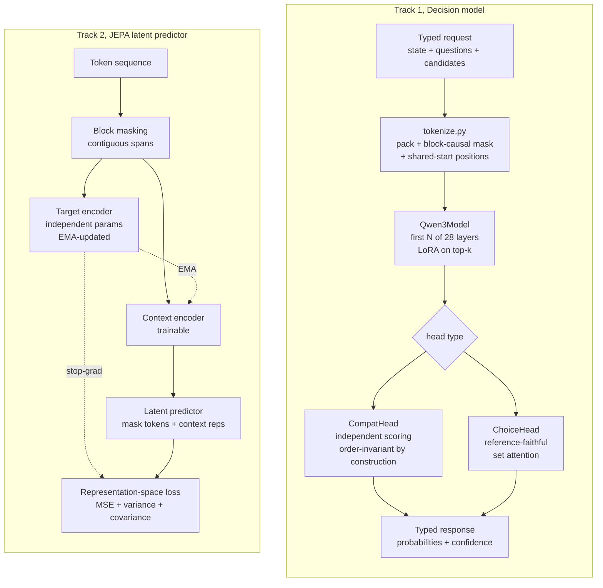
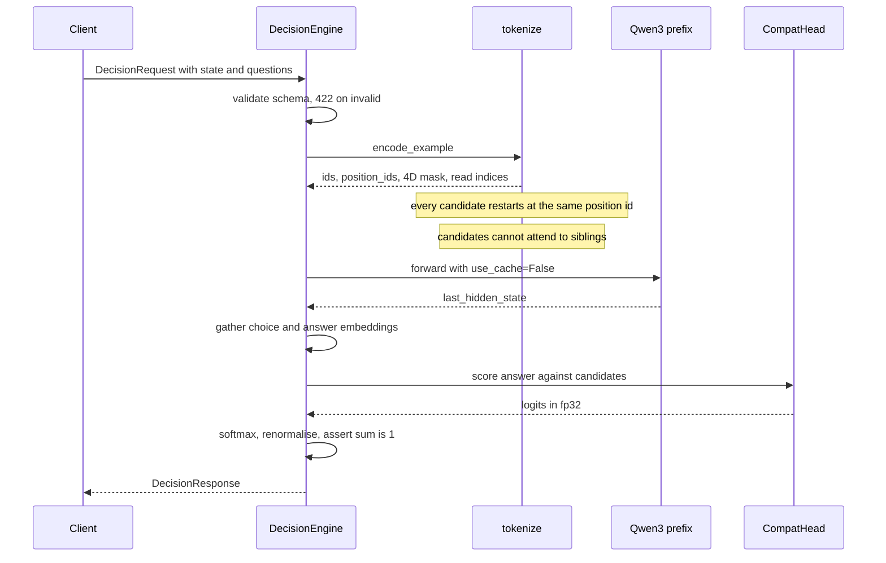

<div align="center">

# mini jepa using qwen

### Order-invariant decision models and a JEPA-style latent predictor on a truncated Qwen3 backbone

**Zero-token inference · Near-exact candidate-order invariance · Calibrated probabilities · EMA-target self-supervision**

[](https://github.com/bharqav/mini-jepa/actions/workflows/ci.yml)
[](https://github.com/bharqav/mini-jepa/actions/workflows/codeql.yml)
[](https://www.python.org/downloads/)
[](LICENSE)
[](https://github.com/astral-sh/ruff)

</div>

---

`mini-jepa` turns a pretrained causal language model into something that
**answers questions instead of completing text**. Give it a state, a question,
and a set of candidate answers; it returns a calibrated probability
distribution, in a single forward pass, generating **zero tokens**.

It also contains a JEPA-style latent predictor that learns representations by
predicting masked spans in a target encoder's embedding space, rather than by
predicting tokens.

> **Naming:** the distribution is `mini-jepa`; the importable package is
> `jev_qwen` (`from jev_qwen.infer import DecisionEngine`).

> **Why build this?** Autoregressive generation is a poor fit for structured
> decision problems: you pay for tokens you did not ask for, you get invalid
> output that must be parsed and validated, and you cannot permute the options
> without the answer changing. This project removes all three problems while
> keeping the pretrained knowledge.

---

## Architecture

Two independent tracks share one repository.



### Decision Path, one forward pass, zero tokens



---

## Features

| Capability | Implementation | Status |
|-----------|----------------|--------|
| **Zero-token inference** | Single forward pass, `use_cache=False`, no `generate()`; asserted absent | ✅ |
| **Order invariance** | Shared scoring projections + shared-start position IDs | ✅ exact (head), ~3e-3 end-to-end |
| **Question isolation** | Independent row per question; packed-vs-independent equivalence tested | ✅ |
| **Two head variants** | `CompatHead` (independent) and `ChoiceHead` (reference-faithful) | ✅ ablated |
| **Three question types** | `choice`, `score` (expected level + normalised), `noul` (P(Yes)) | ✅ |
| **JEPA latent prediction** | EMA target encoder, block masking, predictor, VICReg terms | ✅ non-collapsed |
| **Collapse diagnostics** | Per-dim std, collapse ratio, covariance norm, linear CKA | ✅ |
| **Calibration** | Temperature scaling with fit/measure split, ECE, risk-coverage, SVG diagrams | ✅ |
| **Uncertainty** | Bootstrap CIs over rows; cross-seed aggregation and comparison | ✅ |
| **Stratified evaluation** | Accuracy + 95% CI per domain and per candidate count | ✅ |
| **Parameter-efficient training** | LoRA on attention projections + trainable head | ✅ |
| **Serving** | FastAPI with liveness/readiness split, size limits, OOM backoff | ✅ |
| **Local teacher labelling** | Local LM or external HTTP teacher, with retry and caching | ✅ |

---

## Measured Results

All numbers produced by executable scripts on a held-out split of
`avbiswas/bev-decision-150K` that was never used for training or model
selection. See [`results/`](results/) and [`docs/experiments.md`](docs/experiments.md).

**Backbone:** `Qwen/Qwen3-0.6B`, first 12 of 28 layers, LoRA on the last 4.

### Head comparison, 3 epochs, 3 seeds, identical data and budget

Mean ± sample std across seeds 0, 1 and 2. Seed 0 is the original run
re-evaluated with the pinned dataset/model revisions and the current test
loader; seeds 1 and 2 were trained with the pinned revisions.

| System | Accuracy | NLL | Brier | ECE | choice | noul | score | macro-F1 | AUC | head-order TV |
|--------|----------|-----|-------|-----|--------|------|-------|----------|-----|----------------|
| reference `ChoiceHead` | 0.629 ± 0.031 | 0.799 ± 0.052 | 0.456 ± 0.030 | **0.029 ± 0.010** | 0.595 ± 0.043 | 0.709 ± 0.025 | 0.477 ± 0.010 | 0.640 ± 0.034 | 0.779 ± 0.023 | 2.4e-6 |
| **`CompatHead` (default)** | **0.667 ± 0.053** | **0.734 ± 0.084** | **0.422 ± 0.049** | 0.041 ± 0.003 | **0.662 ± 0.089** | **0.718 ± 0.019** | **0.510 ± 0.046** | **0.730 ± 0.050** | **0.808 ± 0.021** | **9.0e-8** |

Per-seed accuracy:

| System | seed 0 | seed 1 | seed 2 |
|--------|--------|--------|--------|
| `CompatHead` | 0.6065 | 0.6935 | 0.7015 |
| `ChoiceHead` | 0.5950 | 0.6545 | 0.6365 |

The single-seed table this replaces reported 0.600 vs 0.581. With three seeds
the compat gap is +0.0385 (SE 0.0352, t ≈ 1.10), **not significant at 95%**.
The compat head is higher for every seed, but the seed spread is large enough
that a 3-epoch accuracy advantage is not established. The reference head is
better calibrated at this budget (ECE 0.029 vs 0.041).

### Seed variance, 3 seeds per system, 1 epoch

| System | mean | std | per-seed |
|--------|------|-----|----------|
| `CompatHead` | **0.5593** | **0.0008** | 0.5585, 0.5600, 0.5595 |
| `ChoiceHead` | 0.5247 | 0.0184 | 0.5050, 0.5415, 0.5275 |

Δ = +0.035, t = 3.26 (**significant at 95%**). At 1 epoch every `CompatHead`
run beats every `ChoiceHead` run, and the compat head is ~23× more
seed-stable. That stability does **not** carry to 3 epochs: there the compat
std is 0.053 vs 0.031 for the reference head, so the 1-epoch result should not
be generalized.

### On order invariance, two different guarantees

These are routinely conflated, so this project measures them separately:

| Level | What is permuted | `CompatHead` | `ChoiceHead` |
|-------|------------------|--------------|--------------|
| **Head-level** | `choice_read_idx` inside a fixed tokenised batch | **≤9e-8 TV** | 2.4e-6 TV |
| **End-to-end** | the token sequence itself (full re-tokenisation) | **~3.2e-3** max Δ | not measured |

The head is invariant by construction: each candidate is scored by a
pure function of `(answer, candidate_i)` using shared projections. The
measured residual (≤9e-8 TV) is float32 reduction order, not a dependence on
position. The end-to-end number is larger because the *answer* token attends
over all candidates, so permuting them changes the float32 summation order
inside the backbone. In practice the selected candidate was identical across all three
orderings tested, but this is not a mathematical guarantee at the pipeline
level, only at the head level.

If you need strict end-to-end invariance, constrain the answer read-out (e.g.
pool candidate representations commutatively) rather than relying on the head
alone.

### Against baselines, same held-out split (1 epoch)

| System | Accuracy | NLL |
|--------|----------|-----|
| majority class (per type) | 0.293 choice / 0.544 noul / 0.269 score |, |
| next-token letter scoring (frozen) | 0.401 | 2.960 |
| zero-shot generation (full 28 layers) | 0.520 |, |
| **`CompatHead` + LoRA (zero tokens)** | **0.559** | **0.933** |

The trained head exceeds zero-shot full-model generation on accuracy while
emitting no tokens at all.

### Epoch scaling (seed 0 only)

| Epochs | 1 | 3 | 5 |
|--------|---|---|---|
| Accuracy | 0.559 | 0.600 | 0.614 |
| Raw ECE | 0.021 | 0.048 | 0.082 |

This ablation holds the seed fixed at 0, so it isolates training length but
not seed noise. The 3-epoch seed-0 point (0.600) is an unlucky draw: the
3-seed mean is 0.667 ± 0.053. Do not compare the 5-epoch single run directly
to the multi-seed mean. At seed 0, 3 epochs still has the best NLL and
calibration, and 5 epochs is overconfident (fitted temperature 1.95), but the
epoch choice itself has not been rerun across seeds.

### Where it fails

Accuracy by candidate count (seed-0 checkpoint, choice questions only):

| C | 2 | 3 | 4 | 5 | 6 | 8 |
|---|---|---|---|---|---|---|
| accuracy | 0.665 | 0.584 | 0.580 | 0.585 | 0.463 | **0.392** |

Many-way choice is the clear weak spot. Per-domain spread is wide (software
security 0.389 → spam detection 0.917), so performance depends heavily on
question *shape*, not just difficulty.

### Efficiency

RTX 5060 (8.1 GB) via WSL2, CUDA 12.8 wheels:

| Metric | Value |
|--------|-------|
| Peak training VRAM | 3.3 GB |
| Peak inference VRAM | 1.3 GB |
| Single-question latency (median) | 21 ms |
| Throughput @ batch 16 | 369 q/s |
| Tokens generated per decision | **0** |

> Reproduce with `make bench CKPT=<path>`. Latency includes tokenisation,
> one backbone pass and head scoring; timing is CUDA-synchronised and warmed up.

---

## Project Status

> **Alpha, research code.** Correct and tested, not fully production-hardened.
> Security now covers bearer authentication, rate limiting, safetensors-only
> checkpoint loading and pinned hub revisions; TLS must be terminated by a
> reverse proxy. The 3-epoch headline figures are a 3-seed mean ± std.
> See [`docs/production.md`](docs/production.md) for an honest account of
> what is and is not implemented.

---

## Quick Start

### Install

```bash
git clone https://github.com/bharqav/mini-jepa.git
cd mini-jepa
make install            # CPU torch + dev extras
# or, for CUDA:
make install-gpu
```

<details>
<summary>Manual install</summary>

```bash
python -m venv .venv && source .venv/bin/activate    # Windows: .venv\Scripts\activate
pip install torch --index-url https://download.pytorch.org/whl/cu128
pip install -e ".[dev]"
```

</details>

### Run a decision

```bash
# From a request file
python scripts/decide.py --checkpoint <ckpt> --batch examples/request.json

# Or ad hoc
python scripts/decide.py --checkpoint <ckpt> \
  --state "A server is returning repeated HTTP 503 errors." \
  --type choice --question "What should the operator do first?" \
  --candidate "inspect:Inspect service health and dependencies." \
  --candidate "delete:Delete the production database." \
  --candidate "ignore:Ignore the incident."
```

```json
{
  "results": [
    {
      "id": "q0",
      "type": "choice",
      "scores": [
        { "id": "inspect", "score": 0.2747 },
        { "id": "delete",  "score": 0.0498 },
        { "id": "ignore",  "score": 0.6755 }
      ],
      "selected": "ignore",
      "confidence": 0.6755
    }
  ],
  "model_version": "mini-jepa-0.2.0@best"
}
```

> Captured verbatim from the shipped 3-epoch `CompatHead` checkpoint on the
> state shown above. Note the model is **wrong** on this example, "ignore the
> incident" is not the right first action, which is a fair illustration of the
> accuracy numbers above: use the `confidence` field, do not trust the argmax
> blindly.

Reordering the candidates gives the identical `selected` id (probabilities
drift by ~3e-3 from float summation order, see the invariance table above).

### Train

```bash
python scripts/prepare_data.py --max-train 20000 --max-test 2000
python scripts/train.py configs/improved.yaml --name my-run
python scripts/evaluate.py runs/my-run-<timestamp>/checkpoints/best --split test
```

A CPU-only end-to-end smoke test takes a couple of minutes:

```bash
make smoke        # overfits 10 questions; loss should drop sharply
make jepa         # JEPA latent-prediction smoke experiment
```

### Serve

```bash
export JEV_API_TOKEN="$(python -c 'import secrets; print(secrets.token_urlsafe(32))')"
export JEV_CHECKPOINT=<path to checkpoint>
python -m uvicorn jev_qwen.api:app --host 127.0.0.1 --port 8000
```

For multiple scoped keys, set `JEV_API_KEYS` (JSON) or
`JEV_API_KEYS_FILE` instead of `JEV_API_TOKEN`; see
[`scripts/generate_api_keys.py`](scripts/generate_api_keys.py). A key may have
only the `decide` or `answer` scope and an optional per-key `rps`/`burst`
quota. The service refuses to start if no key is configured. For local-only use
you can opt out explicitly with `JEV_DEV_MODE=1` (or
`python -m jev_qwen.api --dev`), which logs a loud warning because
authentication is off.

Requests carry an `X-Request-ID` (supplied or generated) in the response and
structured access logs. Prometheus metrics are at `/metrics`; keep that
endpoint on a private network.

```bash
curl -s http://127.0.0.1:8000/v1/decide \
  -H "Authorization: Bearer $JEV_API_TOKEN" \
  -H "Content-Type: application/json" \
  -d @examples/request.json
```

| Method | Path | Auth | Description |
|--------|------|------|-------------|
| `GET` | `/health` | no | Liveness, process is up |
| `GET` | `/ready` | no | Readiness, `503` until weights are loaded |
| `GET` | `/v1/models` | no | Model card |
| `POST` | `/v1/decide` | bearer | Batch decision request |
| `POST` | `/v1/answer` | bearer | Compatibility adapter (single question) |
| `GET` | `/metrics` | no | Prometheus metrics (restrict at the edge) |
| `GET` | `/demo` | dev only | Minimal browser demo (404 when auth is on) |

Interactive API docs are served at `/docs` when the app is running. TLS is not
terminated in-process; run behind a reverse proxy such as the provided
[`deploy/nginx.conf.example`](deploy/nginx.conf.example). Container and systemd
templates live in [`deploy/`](deploy/README.md).

---

## API Reference

### `POST /v1/decide`

```jsonc
{
  "state": "A server is returning repeated HTTP 503 errors.",
  "questions": [
    {
      "id": "q0",
      "type": "choice",              // "choice" | "score" | "noul"
      "question": "What should the operator do first?",
      "candidates": [               // 2+ for choice; exactly 2 for noul
        { "id": "inspect", "text": "Inspect service health." },
        { "id": "ignore",  "text": "Ignore the incident." }
      ]
    }
  ],
  "settings": { "temperature": 1.0, "include_metadata": false }
}
```

Responses include per-candidate scores, a `selected` id (choice/noul),
`confidence`, and, for `score` questions, `expected_level` and
`normalized_score ∈ [0, 1]`.

### Error contract

| Status | Meaning |
|--------|---------|
| `401` | Missing or invalid bearer token on `/v1/decide` or `/v1/answer` |
| `403` | The key is valid but lacks the endpoint's scope |
| `422` | Schema violation, empty questions, duplicate ids, wrong candidate counts. **Never** answered with a fabricated prediction |
| `413` | Exceeds `JEV_MAX_BODY_BYTES`, `JEV_MAX_STATE_CHARS`, `JEV_MAX_QUESTIONS`, or `JEV_MAX_CANDIDATES` |
| `429` | Rate limit exceeded; `Retry-After` gives the delay in seconds |
| `503` | Model not ready, unrecoverable CUDA OOM, or the concurrency limit is full (`Retry-After: 1`) |
| `500` | Unexpected internal error (logged with a request id) |

---

## Configuration

| Variable | Default | Description |
|----------|---------|-------------|
| `JEV_CHECKPOINT` | *(none)* | Checkpoint directory loaded at startup |
| `JEV_API_TOKEN` | *(none)* | Legacy single bearer token; use one of the key variables below for scopes/rotation |
| `JEV_API_KEYS` | *(none)* | JSON map of key id to token or `{token, scopes, rps, burst}` |
| `JEV_API_KEYS_FILE` | *(none)* | Path to the same JSON document (mutually exclusive with `JEV_API_KEYS`) |
| `JEV_TRUSTED_PROXIES` | *(none)* | Comma-separated CIDRs allowed to supply `X-Forwarded-For` |
| `JEV_DEV_MODE` | `0` | Explicitly disable authentication (loud warning; local use only) |
| `JEV_RATE_LIMIT_RPS` | `20` | Per-client token-bucket refill rate per second; `0` disables |
| `JEV_RATE_LIMIT_BURST` | `40` | Per-client token-bucket capacity |
| `JEV_RATE_LIMIT_MAX_CLIENTS` | `4096` | Cap on tracked client buckets; least-recently-used evicted first |
| `JEV_MAX_CONCURRENCY` | `0` | Max simultaneous inference requests; `0` = unbounded. Set `1` per GPU |
| `JEV_MAX_BODY_BYTES` | `1000000` | Reject declared bodies larger than this with `413` |
| `JEV_MAX_STATE_CHARS` | `20000` | Reject larger states with `413` |
| `JEV_MAX_QUESTIONS` | `32` | Reject larger question counts with `413` |
| `JEV_MAX_CANDIDATES` | `64` | Reject larger candidate lists with `413` |
| `JEV_METRICS_ENABLED` | `1` | Serve Prometheus metrics at `/metrics` |
| `JEV_LOG_LEVEL` | `INFO` | Standard logging level |
| `JEV_OTEL_ENABLED` | `0` | Enable OpenTelemetry tracing (requires the `otel` extra) |
| `JEV_OTEL_ENDPOINT` | *(none)* | OTLP/HTTP trace endpoint |
| `JEV_OTEL_SERVICE_NAME` | `jev-qwen` | Service name reported to the trace backend |
| `JEV_REAL_WEIGHTS` | *(unset)* | Set to `1` to run the real-weights test suite |
| `JEV_TEACHER_URL` | *(none)* | External teacher endpoint (optional) |
| `JEV_TEACHER_KEY` | *(none)* | Bearer token for the teacher endpoint |

---

## Package Structure

```
src/jev_qwen/
├── schema.py         # Typed request/response models + probability validation
├── tokenize.py       # Packing, block-causal mask, shared-start position IDs
├── model.py          # DecisionNetwork, CompatHead, ChoiceHead, LoRA wiring
├── jepa.py           # JEPA state: encoders, predictor, EMA, collapse metrics
├── data.py           # Loading, validation, dedup, grouped splits, collation
├── adapters.py       # Pluggable dataset sources (JSONL, synthetic)
├── teacher.py        # Optional offline labelling with retry + accounting
├── train.py          # Training loop, accumulation, scheduling, checkpointing
├── evaluate.py       # Metrics, order-sensitivity, stratified evaluation
├── calibration.py    # Temperature scaling, bootstrap, reliability diagrams
├── stats.py          # Bootstrap CIs and cross-seed comparison
├── infer.py          # DecisionEngine (batching, OOM backoff, determinism)
├── api.py            # FastAPI service
├── run_logger.py     # Run artefacts and self-contained checkpoints
└── utils.py          # Devices, seeding, mixed precision, environment info
```

---

## Engineering Decisions

### Decision: score candidates independently instead of attending over them

**Why:** Invariance becomes *exact at the head*. With shared projections,
`score_i` depends only on `(answer, candidate_i)`, so permuting the read order
cannot change any score; the measured residual is **≤9e-8 TV** (float32
reduction order).

**Alternatives:** the reference `ChoiceHead` uses self-attention across the
candidate set. It is permutation-*equivariant* in exact arithmetic, but
inter-candidate edges plus floating-point reduction order make the measured
sensitivity larger (3.4e-6). Both are implemented and ablated.

**Trade-off:** no cross-candidate interaction in the head. The backbone still
sees the full candidate set (under a block-causal mask), so candidates are not
isolated at the representation level, only at the scoring level. Consequently
*end-to-end* invariance (re-tokenising in a different order) is only ~3e-3,
not exact, because the answer token's attention summation order changes.

### Decision: compute deterministic things, don't learn them

Any question with an exact answer, "is 58 kg under the limit?", "what does
this estimate score?", is computed, not inferred. Putting a network on that
path would add error where the rules are already exact and make results
unauditable.

### Decision: leave uncertain questions unlabelled

Scenario generators emit `label=None` for questions with no formula rather than
inventing a plausible answer. Fabricated ground truth is worse than no data.

### Decision: `num_workers: 0` by default

DataLoader workers use fork/forkserver, which is unreliable under WSL2 and on
locked-down Windows. Correctness over throughput; raise it only after
profiling.

### Decision: derive dataset cache fingerprints from source

`datasets` caches mapped tables keyed by a fingerprint that does not track
changes to a module-level function. A newly added column silently came back
empty. `_map_fingerprint()` hashes the mapping function's source so schema
changes invalidate the cache automatically.

---

## Failure Modes & Reliability

| Situation | Behaviour |
|-----------|-----------|
| Malformed request | `422`, never a fabricated answer |
| Oversized request | `413` before any model work |
| Missing or invalid token | `401` on the inference endpoints |
| Rate limit exceeded | `429` with `Retry-After` |
| CUDA OOM | Chunk size halves and retries down to one question; `503` only if unrecoverable |
| Model not loaded | `/ready` returns `503`, `/v1/decide` returns `503` |
| Invalid probability vector | `validate_response` raises rather than returning it |
| Checkpoint/architecture mismatch | `load_checkpoint` raises; LoRA presence is cross-checked against config |
| Legacy `head.pt` checkpoint | Refused with conversion instructions; the unsafe pickle is never loaded |
| Dataset cache stale | Invalidated automatically via source-derived fingerprint |

Determinism is verified: five identical GPU requests returned **max score
delta 0.0**. (`inference_metadata.latency_s` naturally varies, compare
`results`, not the whole envelope.)

---

## Security

Implemented: scoped bearer authentication on the inference endpoints
(constant-time comparison via `hmac.compare_digest`, fail closed unless an
explicit dev mode is enabled), key rotation by running multiple keys, per-client
and per-key rate limiting, trusted-proxy client resolution, a bounded
concurrency cap, strict input validation, body/state/field size limits,
readiness gating, OOM resource control, safetensors-only checkpoint loading,
pinned Hugging Face revisions, request IDs, structured audit/access logs that
exclude request bodies and credentials, Prometheus metrics, optional
OpenTelemetry tracing, secret scanning, and a `pip-audit` dependency scan in CI.

**Not implemented:** a user database or per-tenant isolation (one key grants
inference), cluster-wide rate limiting (buckets are per instance; N replicas
enforce N budgets), in-process TLS termination, and a WAF/connection cap beyond
the edge examples. TLS is provided by a reverse proxy; see
[`deploy/nginx.conf.example`](deploy/nginx.conf.example). Full threat model in
[`SECURITY.md`](SECURITY.md).

---

## Testing

```bash
make test        # weight-free: no model download required
make test-real   # full suite with real Qwen3-0.6B (~1.2 GB, cached afterwards)
```

| Layer | Coverage |
|-------|----------|
| Invariants | Candidate permutation (exact + tolerance), question isolation, packed-vs-independent |
| Correctness | Batch-vs-single agreement, padding, variable lengths, probability normalisation, candidate/label alignment |
| Calibration | Temperature recovery for over/under-confidence, ECE, risk-coverage thresholds, SVG validity |
| JEPA | Target-encoder isolation (no gradients), EMA exactness, no trivial copy, collapse detection |
| Data | Schema validation, grouped splits with no leakage, adapters, duplicate rejection |
| API | Health/readiness gating, limits, error contract, structured logging, scoped auth, rate limits, metrics, concurrency, demo page |
| Teacher | Cache reuse, validation rejection, real-HTTP retry/backoff/accounting |
| Integration | Tiny train → save → **fresh-process** reload → evaluate |

---

## Documentation

| Document | Description |
|----------|-------------|
| [docs/architecture.md](docs/architecture.md) | Decision model design and isolation mechanism |
| [docs/architecture_jepa.md](docs/architecture_jepa.md) | JEPA design, and what makes it non-canonical |
| [docs/experiments.md](docs/experiments.md) | Every experiment, including negative results |
| [docs/evaluation.md](docs/evaluation.md) | Metrics definitions and methodology |
| [docs/dataset.md](docs/dataset.md) | Dataset schema and split hygiene |
| [docs/model_card.md](docs/model_card.md) | Intended use, metrics, limitations, dataset-license caveat |
| [docs/production.md](docs/production.md) | Serving behaviour, limits, and known gaps |
| [deploy/README.md](deploy/README.md) | Compose/systemd deployment, key rotation, metrics, load test |
| [THIRD_PARTY_NOTICES.md](THIRD_PARTY_NOTICES.md) | Backbone/dataset and runtime licenses |
| [docs/environment.md](docs/environment.md) | Platform notes and fallbacks |
| [results/notes.md](results/notes.md) | Full experiment log with measured numbers |

---

## Roadmap

**Implemented**, everything in the features table above.

**Planned**
- Downstream probe evaluation for the JEPA representations
- Quantised CPU inference path for edge deployment

**Not planned**
- Autoregressive decoding in the decision path (this is the point of the project)

---

## Contributing

See [CONTRIBUTING.md](CONTRIBUTING.md). Short version: `make install`, branch,
`make check`, open a PR.

## License

MIT, see [LICENSE](LICENSE).

## Acknowledgements

- [avbiswas/bev-train](https://github.com/avbiswas/bev-train), the decision
  architecture this project reproduces and then improves
- [`avbiswas/bev-decision-150K`](https://huggingface.co/datasets/avbiswas/bev-decision-150K), evaluation dataset
- Assran et al., *Self-Supervised Learning from Images with a Joint-Embedding
  Predictive Architecture* (CVPR 2023), the JEPA formulation
- Bardes et al., *VICReg*, variance/invariance/covariance regularisation