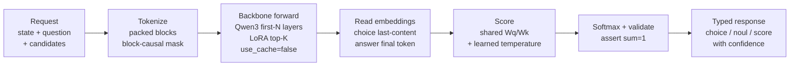
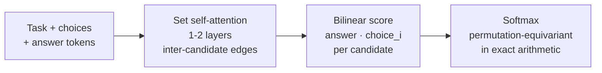
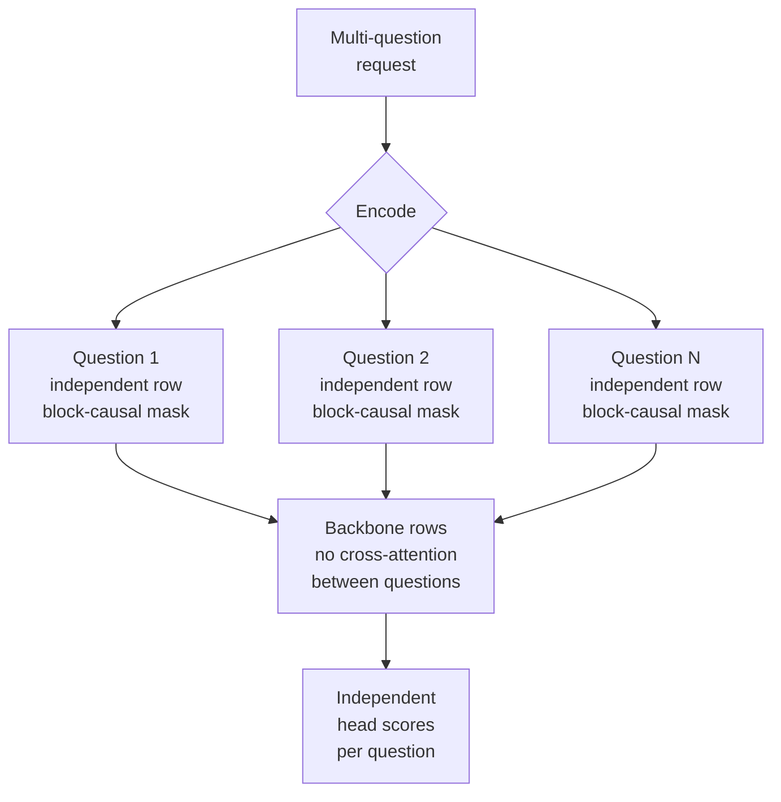

# Decision Architecture (Qwen3-0.6B backbone, zero-token inference)

## Pipeline

`state + question + candidates` → `tokenize.encode_example` → packed sequence
`[question/state][choice_0]...[choice_k][answer prompt]` → one Qwen3Model
forward with block-causal mask + shared choice position IDs → read choice
embeddings at last content token of each choice + answer embedding at final
token → decision head → softmax → typed response. `generate()` is never
called; `DecisionNetwork` exposes no generation path (asserted in tests).



## Reference head (`reference`)

Faithful port of `avbiswas/bev-train` `ChoiceHead`: task embedding prepended
to `[task, choices..., answer]`, 1-2 self-attention layers over the set, then
bilinear `answer·choice` scoring. Permutation-equivariant in exact arithmetic
(no order terms in set attention); measured order TV ≈ 1e-6 (fp noise only).



## Improved head (`compat`)

`CompatHead`: LayerNorm → shared `Wq` (answer) / `Wk` (choices) projections →
scaled dot product + learned per-task bias, divided by learned per-task
temperature. No inter-candidate attention, so each score depends only on
`(answer, choice_i)` with shared parameters: **exactly** order-invariant
(measured TV ≈ 1e-8-1e-7) and cheaper. Candidates stay comparable because all
share `Wq/Wk`.

```mermaid
flowchart LR
    A[Answer embedding] --> C[Scaled dot product\nWq(a) · Wk(c_i) / √d\n+ learned bias]
    B[Candidate embeddings] --> C
    C --> D[Divide by\nlearned per-task\ntemperature]
    D --> E[Softmax\norder-invariant\nby construction]
```

## Why order invariance holds

1. Position IDs: every choice span restarts at the same position (`tokenize.generate_position_ids`).
2. Attention: choice blocks see the question + themselves, never siblings (`tokenize.get_attention_mask`).
3. Scoring: shared parameters across candidates (both heads).
4. Alignment: scores are mapped back to candidate IDs before comparison; training augmentation (`permute_candidates`) additionally shuffles read order with remapped labels.

## Two levels of invariance (measured separately)

| Level | What is permuted | `CompatHead` | `ChoiceHead` |
|-------|------------------|--------------|--------------|
| **Head-level** | `choice_read_idx` within a fixed tokenised batch | **exactly 0.0** | 3.4e-6 TV |
| **End-to-end** | the token sequence (full re-tokenisation) | **~3.2e-3** max Δ | not measured |

**Head-level is exact by construction.** `score_i = Wq(a)·Wk(c_i)/√d` is a pure
function of the answer vector and candidate *i*, so re-reading candidates in a
different order cannot change any score. The unit test asserts `atol=1e-5` and
measures exactly 0.0.

**End-to-end is not exact, and cannot be while the answer attends over
candidates.** The packed sequence changes when candidate order changes, so the
answer token's attention summation order changes, and float32 reduction is not
associative. Measured drift on the shipped checkpoint: max Δ = 3.2e-3 across
three orderings, with the argmax unchanged.

`evaluate.order_sensitivity` measures the head-level guarantee only, and its
docstring says so explicitly. Conflating the two would overstate the result.

If strict end-to-end invariance is required, the answer read-out must become
commutative (e.g. mean-pooling candidate representations, which is already
order-independent) instead of attending across them.

## Question isolation

Multi-question requests are encoded as independent rows (one backbone row per
question). Packed multi-question execution inside one sequence is NOT used, isolation by construction, verified by mask tests (sibling blocks unattended)
and packed-vs-independent agreement tests.



