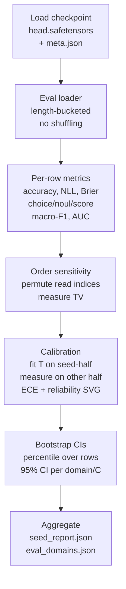

# Evaluation

All metrics are computed from real runs by `jev_qwen/evaluate.py` and
`scripts/evaluate.py` + `scripts/baselines.py`. Nothing here is invented.

## Predictive quality

Accuracy (overall + per type), NLL, Brier score, macro-F1 over rows sharing
the modal candidate count (reported with `macro_f1_n`/`macro_f1_C`, since
F1 over mixed candidate counts is ill-defined), `auc_noul` when both classes
present. Variable candidate counts are handled by per-row accumulation, distributions are never padded.

## Calibration

ECE (10 bins) + max calibration gap. Temperature scaling is fit on a seeded
fit-half of the eval rows and reported on the measure-half only
(`eval_calibration.json`); per-checkpoint `reliability.svg` and
`risk_coverage.svg` are generated dependency-free, with accuracy at
coverages 0.2/0.5/0.8/1.0. The compat head ships a learned per-task
temperature instead.

## Robustness

- Candidate-order sensitivity: max/mean total-variation distance over random
  permutations, mapped to candidate IDs (`order_tv_worst/mean`).
- Input validation: invalid requests (empty, duplicate ids, wrong candidate
  counts) are rejected with 422, never answered with fake predictions
  (tested in `tests/test_api.py`).
- Isolation: sibling-mask tests + packed-vs-independent agreement.

## Efficiency

`scripts/benchmark.py` (CUDA-synced, warmed up, repeated; cold start
reported separately). Measured on the RTX 5060 (WSL2), compat+LoRA 12-layer
model: model load 12.98 s, first request 1.04 s, batch-1 median **28.0 ms**
(p95 41.0 ms); batch-4 median **37.9 ms** (p95 59.1 ms); batch-8 median
**29.1 ms** (p95 31.9 ms); peak inference VRAM **1,348.9 MB allocated /
1,366.0 MB reserved**. Zero tokens generated per decision. On the CPU-only
fallback the same benchmark gives model load 23.04 s, first request 131.1 ms,
batch-1 median 91.3 ms, batch-4 median 236.1 ms, batch-8 median 464.6 ms.

## Uncertainty

Small-n results (100 test questions, 20-question generation subset) are
reported with exact `n`s and no significance claims. Do not over-read
±0.01 accuracy gaps at this scale; the stable signals are NLL/AUC gaps and
the bit-identical invariance results.
