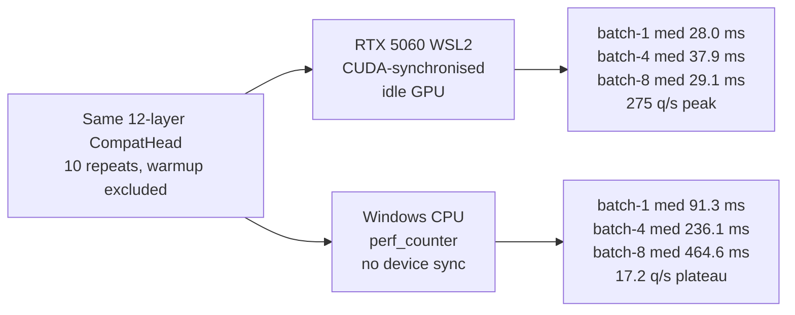

# Experiments

Numbers live in `results/` (`notes.md`, `comparison.csv`,
`final_metrics.json`) so they are version-controlled; raw per-run logs stay
in the git-ignored `runs/`. Everything was produced by executable scripts, nothing is estimated.

## Headline (GPU: RTX 5060 via WSL2, 20k questions, 12 layers + LoRA, 3 epochs)
Held-out test split of 2,280 questions; the config evaluates the first 2,000
after a fixed shuffle, and that subset is identical across seeds. Numbers are
mean ± sample std across seeds 0, 1 and 2 (seed 0 is the original run
re-evaluated with the pinned revisions and current loader).

| system | acc | NLL | Brier | ECE | choice | noul | score | macro-F1 | AUC | order TV |
|---|---|---|---|---|---|---|---|---|---|---|
| majority |, |, |, |, | 0.293 | 0.544 | 0.269 |, |, |, |
| next-token (frozen) | 0.401 | 2.960 |, |, |, |, |, |, |, |, |
| zero-shot generation (full 28L, n=50) | 0.520 |, |, |, |, |, |, |, |, |, |
| reference head, 3 ep | 0.629 ± 0.031 | 0.799 ± 0.052 | 0.456 | 0.029 | 0.595 | 0.709 | 0.477 | 0.640 | 0.779 | 2.4e-6 |
| **compat head, 3 ep** | **0.667 ± 0.053** | **0.734 ± 0.084** | **0.422** | 0.041 | **0.662** | **0.718** | **0.510** | **0.730** | **0.808** | **9.0e-8** |

Per-seed accuracy: compat 0.6065 / 0.6935 / 0.7015; reference 0.5950 /
0.6545 / 0.6365. The compat gap is +0.0385 (SE 0.0352, t ≈ 1.10), **not
significant at 95%**. Compat is higher on accuracy, NLL, Brier, choice, noul,
score, macro-F1 and AUC; the reference head calibrates better at 3 epochs
(ECE 0.029 vs 0.041).

The earlier single-seed table (0.600 vs 0.581) was an unlucky seed-0 draw for
both heads and overstated the 3-epoch margin. At 1 epoch the compat margin is
+0.054 and significant (3 seeds, t = 3.26); at 3 epochs it is not established.
Epoch scaling for compat (seed 0 only): 1 ep 0.559 → 3 ep 0.600 → 5 ep 0.614,
ECE 0.048 → 0.082 at 5 epochs (fitted T = 1.95). Three epochs remains the
default on the seed-0 NLL/calibration ablation, but the epoch choice has not
been rerun across seeds, and the 5-epoch single run should not be compared
directly with the 3-seed 3-epoch mean.

## Early CPU ablation (300 questions, frozen), kept for the record
Established the head ranking before scaling: compat NLL 1.310 vs ref 1.677,
AUC 0.768 vs 0.544, choice still below majority. This scale could not
separate the heads on accuracy, which is why Episode 2 exists.

## KEPT / REJECTED improvements
- **KEPT** compat head: better ranking, better 1-epoch calibration, near-exact
  invariance (≤1e-7 TV), cheaper than the reference head; at 3 epochs the
  reference head calibrates better.
- **KEPT** LoRA on the top kept layers: choice 0.225 → 0.300 at CPU scale,
  the single biggest lever found.
- **KEPT** learned per-task temperature (compat head).
- **REJECTED as unnecessary**: order augmentation is a provable no-op for
  the invariant head (bit-identical training loss); retained only because the
  reference head's recipe requires it. Candidate-order invariance is a
  property of the architecture, not of the augmentation.
- **NULL RESULT**: bidirectional JEPA context vs causal, MSE 1.1559 vs
  1.1613 at identical seeds; no measurable difference at toy scale.
- **WEAK TEACHER**: local 4-layer LM teacher agreed with dataset labels on
  1/5 audited rows; not used for training.

## Calibration
On the 1-epoch compat run, temperature scaling was fitted on a seeded 50% half
of the eval rows and measured on the other half (T = 1.014, NLL 0.933 → 0.922,
ECE → 0.032). Reliability and risk-coverage SVGs are emitted per checkpoint.
Selective prediction works: 0.688 accuracy at 50% coverage vs 0.572 overall.

## Efficiency (same GPU, verified idle)

Two hardware contexts are reported separately because the numbers differ by an
order of magnitude. Raw artifacts: `results/benchmark_gpu.json` and
`results/benchmark_cpu.json`.

**RTX 5060 Laptop (8.1 GB) via WSL2, CUDA 12.8, idle GPU, 10 repeats:**

| Metric | Value |
|--------|-------|
| Model load | 12.98 s |
| First request | 1.04 s |
| Batch 1 median / p95 | 28.0 ms / 41.0 ms |
| Batch 1 throughput | 35.7 questions/s |
| Batch 4 median / p95 | 37.9 ms / 59.1 ms |
| Batch 4 throughput | 105.5 questions/s |
| Batch 8 median / p95 | 29.1 ms / 31.9 ms |
| Batch 8 throughput | 275.0 questions/s |
| Peak inference VRAM | 1,348.9 MB |
| Reserved VRAM | 1,366.0 MB |
| Tokens generated per decision | **0** |

**Windows CPU (default Python venv), 10 repeats:**

| Metric | Value |
|--------|-------|
| Model load | 23.04 s |
| First request | 131.1 ms |
| Batch 1 median / p95 | 91.3 ms / 107.9 ms |
| Batch 1 throughput | 11.0 questions/s |
| Batch 4 median / p95 | 236.1 ms / 291.2 ms |
| Batch 4 throughput | 16.9 questions/s |
| Batch 8 median / p95 | 464.6 ms / 551.9 ms |
| Batch 8 throughput | 17.2 questions/s |
| Tokens generated per decision | **0** |

Same-seed reruns are bit-identical; different seeds are not (the 3-epoch compat
accuracy spans 0.6065-0.7015).

## What would come next
A 5-epoch seed sweep (to separate epoch scaling from seed noise), a multi-seed
JEPA probe sweep with a decision-aware auxiliary objective, larger LoRA rank,
harder subsets (`hard_50k`), packed multi-question execution, and an external
teacher with validation, all implemented or configured, none yet measured.

## Episode 7 — Real Qwen3-0.6B JEPA + frozen decision probe (single seed)

This is the first real-weight JEPA run, not the toy 4-layer smoke. Protocol:
Qwen3-0.6B revision `c1899de...`, first 8 decoder layers, packed decision text
(8,000 rows of length 256), 2,000 JEPA steps, batch 8, bf16, RTX 5060 via
WSL2. The probe freezes the backbone and trains only a `CompatHead` for one
epoch on 20,000 train questions; the evaluated test subset is 392 rows and is
identical across all rows below.

| system | pretrain eval MSE | pretrain eval cosine | probe acc | NLL | ECE | choice | noul | AUC |
|---|---|---|---|---|---|---|---|---|
| pretrained Qwen, causal | — | — | **0.5745** | **0.9461** | 0.0427 | **0.5266** | **0.6820** | **0.7336** |
| causal EMA JEPA | 12.33 | 0.571 | 0.3940 | 1.1524 | 0.0256 | 0.2251 | 0.6113 | 0.6471 |
| causal frozen-target JEPA | 12.38 | 0.596 | 0.4975 | 1.0563 | 0.0308 | 0.4246 | 0.6254 | 0.6982 |
| pretrained Qwen, bidirectional | — | — | 0.5390 | 1.0178 | 0.0455 | 0.4512 | 0.6843 | 0.7410 |
| bidirectional EMA JEPA | **6.42** | **0.664** | 0.4185 | 1.1491 | 0.0345 | 0.2539 | 0.6372 | 0.6529 |

The bidirectional rows use `configs/jepa_probe_bidir.yaml` so the probe's
attention matches the JEPA encoder. Bidirectional JEPA has the best latent MSE
and cosine, yet is 12.1 accuracy points below the bidirectional pretrained
baseline (0.4185 vs 0.5390). The causal comparison is 7.7 points below its
baseline (0.4975 vs 0.5745). The result is consistent in both attention modes:
better latent prediction did not produce a better decision representation.

**Verdict: negative result.** Under this single-seed protocol, JEPA
initialisation does not beat the pretrained Qwen baseline on the downstream
decision probe. A seed sweep and an auxiliary decision-aware objective are
required before claiming a JEPA win.

Measured values: `results/jepa_qwen_results.json`. Raw runs (git-ignored):
`runs/jepa-qwen-*`, `runs/jepa-probe-*`.

## Episode 8 - Standard downstream probes (SST-2, STS-B, single seed)

`scripts/evaluate_jepa.py` evaluates frozen representations with a linear ridge
probe and cosine kNN, without task fine-tuning. Protocol: GLUE `sst2` and
`stsb`, 20,000 train / 1,000 eval examples, mean pooling, ridge alpha 1.0,
kNN k=20. Baselines: the same Qwen3-0.6B backbone without JEPA, random-init
Qwen, BERT-base MLM, and SimCSE-BERT-base. Causal JEPA is the frozen-target
checkpoint; bidirectional JEPA uses the matching bidirectional probe.

| task | representation | linear | kNN | R@1 | effective rank |
|---|---|---|---|---|---|
| SST-2 | causal JEPA | 0.828 | 0.752 | - | 165 |
| SST-2 | frozen Qwen | 0.847 | 0.804 | - | 236 |
| SST-2 | random Qwen | 0.575 | 0.588 | - | 157 |
| SST-2 | BERT MLM | **0.856** | 0.812 | - | 150 |
| SST-2 | SimCSE | 0.844 | **0.847** | - | 130 |
| STS-B | causal JEPA | 0.462 | 0.489 | 0.267 | 369 |
| STS-B | frozen Qwen | 0.479 | 0.557 | 0.309 | 450 |
| STS-B | random Qwen | 0.149 | 0.166 | 0.094 | 182 |
| STS-B | BERT MLM | 0.550 | 0.627 | 0.286 | 321 |
| STS-B | SimCSE | **0.747** | **0.828** | **0.405** | 341 |
| SST-2 | bidirectional JEPA | 0.698 | 0.524 | - | **2.5** |
| SST-2 | bidirectional frozen Qwen | **0.815** | **0.734** | - | 241 |
| STS-B | bidirectional JEPA | 0.064 | 0.128 | 0.019 | **6.4** |
| STS-B | bidirectional frozen Qwen | **0.454** | **0.450** | **0.247** | 544 |

SST-2 cells are accuracy; STS-B cells are Spearman correlation. All probes
recover strong signal from frozen Qwen and SimCSE, so the harness is not
degenerate. Causal JEPA remains below frozen Qwen on both tasks and trails
SimCSE by a wide margin on STS-B. The effective-rank diagnostic exposes what
the previous mean-std/collapse-ratio check missed: causal JEPA loses
dimensionality (165 vs 236 on SST-2, 369 vs 450 on STS-B), and bidirectional
JEPA has severe dimensional collapse (rank 2.5 and 6.4) despite a non-zero
per-dimension std. Its latent MSE (6.42) was therefore misleading.

**Verdict: still negative.** JEPA pretraining does not improve these standard
frozen probes. The next experiment should attack representation collapse
(target-side VICReg or a stronger EMA/stop-grad schedule), then rerun the same
probes across seeds before any positive claim. The probe is two-task and
single-seed; it is stronger evidence than the decision-only probe, not a full
JEPA benchmark.

Measured values: `results/jepa_probe_results.json`,
`results/jepa_probe_bidir_results.json`.

## Episode 9 - Context-VICReg collapse fix (negative)

The first attempted fix for Episode 8 added the same VICReg variance and
covariance terms to the masked context representations, not just the
predictor (`configs/jepa_qwen_context_vicreg.yaml`, 2,000 steps, seed 0). This
raised token-level context rank (313) but the EMA target and predictor stayed
collapsed (rank 5.8 and 3.6), and mean-pooled sentence representations were
worse than the original JEPA: SST-2 linear 0.697 / kNN 0.530, STS-B Spearman
0.116 / 0.135, R@1 0.028, sentence effective rank 7.9 / 34.5 (frozen Qwen:
0.847 / 0.804, 0.479 / 0.557, 0.309, rank 236 / 450).

**Verdict: negative.** Regularising masked context tokens does not preserve the
rank of the pooled sentence representation, and the EMA target still collapses.
The next attempt should regularise or whiten the target/pooled representation
itself (or use a projection head), not the context tokens. Artifacts:
`results/jepa_probe_ctx_vicreg.json`.

## Episode 10 - Anchored JEPA and top-block-only adaptation

Two drift controls were tested against the collapse in Episode 8. Both use a
frozen pretrained target (no EMA target) and the same 2,000-step protocol.

| variant | context trainable | anchor | SST-2 linear / kNN | STS-B linear / kNN | STS-B R@1 | sentence rank |
|---|---|---|---|---|---|---|
| frozen target, unanchored | all | 0.0 | 0.828 / 0.752 | 0.462 / 0.489 | 0.267 | 165 / 369 |
| anchored | all | 1.0 | 0.823 / 0.773 | 0.460 / **0.589** | 0.279 | 169 / 370 |
| anchored, top-2 blocks | last 2 | 0.1 | 0.807 / 0.752 | 0.431 / 0.518 | 0.227 | 97 / 293 |
| frozen Qwen | none | - | **0.847 / 0.804** | **0.479 / 0.557** | **0.309** | 236 / 450 |

The full-context anchor is the best JEPA variant measured on STS-B kNN
(0.589 vs 0.557 for frozen Qwen), but it still loses on SST-2 and on STS-B
linear/retrieval, so this is not a win. Restricting adaptation to the top two
blocks made both tasks worse. The anchor preserves more rank than the
unanchored or context-VICReg variants but does not fully close the gap.

**Verdict: no JEPA win yet.** The next useful experiment is a multi-seed anchor
sweep (weight 0.1/0.5/1.0) with the same probes, plus a target/pooled
whitening objective. Artifacts: `results/jepa_probe_anchor.json`,
`results/jepa_probe_top2.json`.
