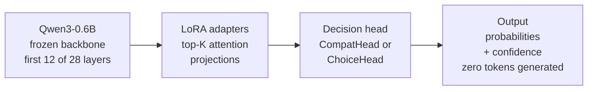

# Model card: jev-qwen decision head

This card describes the checkpoint family produced by this repository, not a
general-purpose language model. The backbone is frozen (or LoRA-adapted); the
trained part is a small decision head that scores candidate answers without
generating text.

## Model details

| item | value |
|------|-------|
| Base model | `Qwen/Qwen3-0.6B` |
| Base revision | `c1899de289a04d12100db370d81485cdf75e47ca` |
| Head variants | `compat` (shared candidate projections) and `reference` (choice head) |
| Parameters trained | head only (plus optional LoRA adapters) |
| Training data | `avbiswas/bev-decision-150K` at `11ed9b5b879e7f9524e7c89c1037d498c54206f0` |
| Task types | `choice` (2–8 candidates), `score` (ordered levels), `noul` (no/yes) |
| Checkpoint format | `head.safetensors` plus `meta.json` and copied config |
| License | code MIT; backbone Apache-2.0; **dataset license is `unknown`** |

The checkpoint records the backbone revision and head config in `meta.json`.
`load_checkpoint` refuses a legacy `head.pt` and cross-checks LoRA presence.

## Intended use

- Structured decision support: pick one candidate, an ordinal level, or a
  no/yes answer from a supplied list.
- Offline evaluation, research on order-invariant decision heads, and
  single-tenant internal tooling behind authentication.
- Assistive settings where a human reviews the selected action.

## Out of scope

- Open-ended generation, chat, summarisation, or free-form reasoning.
- Autonomous execution of high-stakes actions (security, medical, legal,
  financial, destructive infrastructure changes) without human review.
- Adversarial or untrusted input where a wrong selection has immediate
  consequences.
- Multi-tenant exposure: the serving layer has scoped keys but no per-user
  isolation or tenant accounting.
- Domains not represented in the training mix; treat accuracy as
  domain-specific, not a general guarantee.

## Evaluation

Held-out test subset: 2,000 questions (249 score, 902 choice, 849 noul), fixed
across seeds. Three seeds per head, 3 epochs, same data and test rows.

| metric | compat (mean ± std) | reference (mean ± std) |
|--------|---------------------|------------------------|
| accuracy | **0.667 ± 0.053** | 0.629 ± 0.031 |
| NLL | 0.734 ± 0.084 | 0.799 ± 0.052 |
| Brier | 0.422 ± 0.049 | 0.456 ± 0.030 |
| ECE | 0.0414 ± 0.0027 | 0.0295 ± 0.0101 |
| choice accuracy | 0.662 ± 0.089 | 0.595 ± 0.043 |
| noul accuracy | 0.718 ± 0.019 | 0.709 ± 0.025 |
| score accuracy | 0.510 ± 0.046 | 0.477 ± 0.010 |
| macro-F1 | 0.730 ± 0.050 | 0.640 ± 0.034 |
| noul AUC | 0.808 ± 0.021 | 0.779 ± 0.023 |

The 3-epoch compat−reference gap is **+0.0385 (SE 0.0352, t ≈ 1.10)** and is
**not significant at 95%**. The 1-epoch comparison was significant
(+0.035, t = 3.26 over 3 seeds); do not carry that claim to 3 epochs.

Seed-0 epoch scaling (compat): 1 epoch 0.559 → 3 epochs 0.600 → 5 epochs
0.614. The 5-epoch point is single-seed and needs temperature scaling
(T = 1.95) with ECE 0.082, so 5 epochs is not established as the better
choice across seeds.

Accuracy by candidate count (seed-0 choice questions) degrades sharply:
0.665 at C=2 → 0.463 at C=6 → 0.392 at C=8. Many-way choice is the weak spot.

Head-level candidate-order invariance (total variation): compat worst
9.0e-8, reference worst 2.4e-6 (seed 1); seed 0 measured 1.19e-7 / 3.38e-6.
This is head-level only; re-tokenising a different candidate order can change
float summation order (see `docs/architecture.md`).

## Limitations

- **Seed variance is material**: accuracy std is 0.053 for compat, larger than
  the measured head gap.
- **Calibration is not uniform**: ECE is low on average but the 5-epoch point
  is miscalibrated before temperature scaling.
- **Domain shift is unmeasured**; the test split is from the same dataset.
- **No safety, bias, or PII evaluation** has been performed.
- **No paid-teacher validation**: the external teacher path is tested against a
  local HTTP server, not a production provider.
- **Dataset license is unknown**; redistribution and commercial use require
  clarification from the dataset owner. Checkpoints may inherit dataset terms.
- **Not production-hardened as a multi-tenant service**; see
  [`production.md`](production.md) and [`../SECURITY.md`](../SECURITY.md).

## Ethical and legal notes

The model selects among options supplied by the caller; it does not generate
new actions. It can still encode biases present in the dataset and backbone.
Do not use it as the sole decision-maker for consequential actions. The MIT
license covers this repository's code only; the Qwen3 backbone is Apache-2.0
and the dataset card declares `license: unknown`.

## Reproducibility

Pinned backbone and dataset revisions, fixed test rows, three seeds, configs
copied beside checkpoints, and `results/seed3_metrics.csv` record the runs.
`scripts/evaluate.py` and `scripts/seed_report.py` reproduce the tables.
