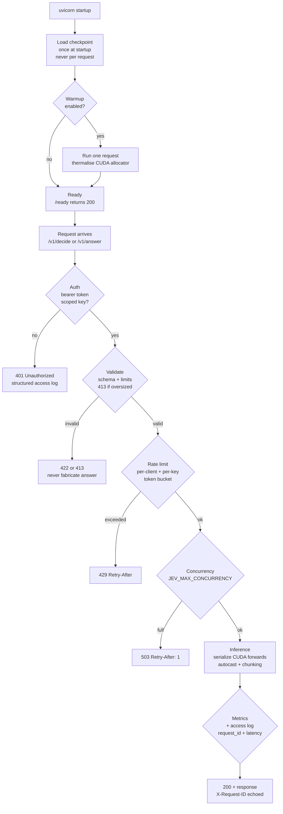
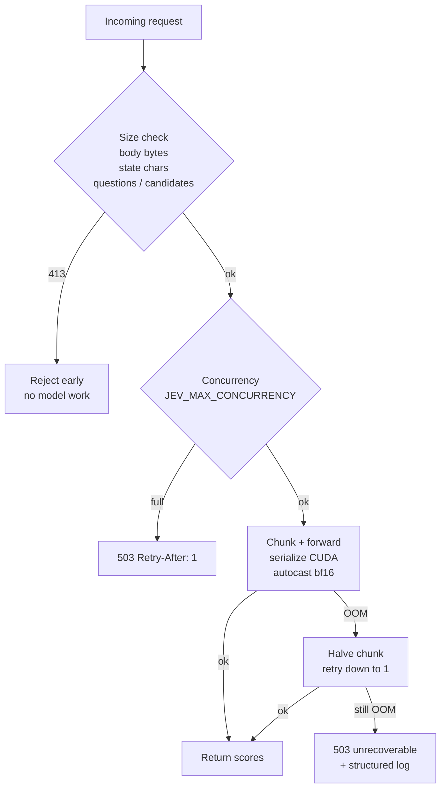

# Production notes

What "production ready" means for this project, and what is verified.

## Serving (`jev_qwen.api`, uvicorn)

| behaviour | status |
|-----------|--------|
| model loaded once at startup, never per request | verified |
| `/health` liveness (always 200 while process up) | verified |
| `/ready` readiness (503 until weights resident) | verified |
| bearer auth on `/v1/decide` and `/v1/answer`; fail closed without a key | verified |
| scoped keys (`decide`, `answer`) with optional per-key `rps`/`burst`; multiple keys supported for rotation | verified |
| explicit dev mode (`JEV_DEV_MODE=1` / `--dev`) disables auth and logs a warning | verified |
| request limits: body bytes, state chars, question count, candidate count → 413 | verified (1MB body, 25000-char state, 40 questions, 64 candidates) |
| request bodies require `Content-Length`; chunked uploads are rejected with 411 | verified |
| `X-Content-Type-Options`, `Cache-Control: no-store`, `Referrer-Policy` on responses | verified |
| invalid schema → 422, never a fabricated prediction | verified |
| in-process per-client token-bucket rate limiting → 429 + `Retry-After`; per-key quota independent | verified |
| bounded concurrency (`JEV_MAX_CONCURRENCY`, 0 = unbounded) → 503 with `Retry-After: 1` when full | verified |
| Prometheus metrics at `/metrics` (when enabled) | verified |
| optional OpenTelemetry tracing (`JEV_OTEL_ENABLED`) | implemented |
| structured JSON logs (`event`, `request_id`, `latency_s`, `error_type`) | verified |
| structured access logs with client + key id, no bodies/tokens | verified |
| graceful shutdown releases the model | implemented |
| CUDA forwards serialized by an in-process lock (no allocator interleaving) | implemented |
| optional startup warmup (`JEV_WARMUP=1`) | implemented |
| TLS termination | **not in-process**; reverse proxy required (`deploy/nginx.conf.example`) |

Tunables via env: `JEV_CHECKPOINT`, `JEV_API_TOKEN`, `JEV_API_KEYS`,
`JEV_API_KEYS_FILE`, `JEV_DEV_MODE`, `JEV_TRUSTED_PROXIES`,
`JEV_RATE_LIMIT_RPS`, `JEV_RATE_LIMIT_BURST`,
`JEV_RATE_LIMIT_MAX_CLIENTS`, `JEV_MAX_CONCURRENCY`, `JEV_MAX_BODY_BYTES`,
`JEV_MAX_STATE_CHARS`, `JEV_MAX_QUESTIONS`, `JEV_MAX_CANDIDATES`,
`JEV_METRICS_ENABLED`, `JEV_LOG_LEVEL`, `JEV_OTEL_ENABLED`, `JEV_OTEL_ENDPOINT`,
`JEV_OTEL_SERVICE_NAME`, `JEV_WARMUP`.

The limiter keeps one bucket per peer address (bounded LRU) and one bucket per
key with a per-key override. With N replicas each instance enforces its own
budget, so the effective cluster limit is N times the configured rate; there is
no shared store. Behind a reverse proxy the client address is taken from
`X-Forwarded-For` only when the peer is in `JEV_TRUSTED_PROXIES`; the app never
trusts the header blindly.

## Checkpoints and hub fetches
- `save_checkpoint` writes `head.safetensors`; `load_checkpoint` reads only
  that file. A legacy `head.pt` is refused rather than loaded, because
  `torch.load` can execute code from an untrusted pickle.
- `scripts/convert_checkpoints.py` migrates old checkpoints once, using
  `torch.load(..., weights_only=True)`. Pass `--delete-old` to remove the
  pickle after conversion.
- The backbone, tokenizer and dataset resolve to pinned commit SHAs via
  `jev_qwen.hub`. Custom names must supply an explicit revision; no path
  fetches an implicit `main`.

## Determinism
Five identical requests returned **max score delta 0.0** on GPU. Note that
`inference_metadata.latency_s` naturally varies between calls, compare
`results`, not the whole envelope.

## Memory behaviour
- Bounded internal chunking (`settings.max_batch`); on CUDA OOM the chunk
  halves and retries down to a single question, so a large request degrades
  in latency rather than failing.
- Measured idle-GPU inference VRAM: **1,348.9 MB** peak allocated /
  **1,366.0 MB** reserved on RTX 5060 (8.1 GB) via WSL2, CUDA 12.8.
- Peak training VRAM at micro-batch 8 x accum 4, bf16, 512 state tokens:
  **3.3 GB** on the same card.
- `max_input_chars` rejects oversized states before any model work instead of
  silently truncating.

## Training / evaluation
- Gradient checkpointing: opt-in via `model.gradient_checkpointing: true`
  (off by default, 3.3 GB already fits the target GPU).
- Length bucketing: `LengthBucketBatchSampler` is used for eval/inference
  loaders to cut padding waste; **training deliberately keeps random
  shuffling** so batch composition stays seed-reproducible.
- `num_workers: 0` is the safe default. DataLoader workers use
  fork/forkserver, which is unreliable under WSL2 and on locked-down
  Windows. Raise it after profiling on a normal host.
- Dataset `.map(num_proc=1)` for the same reason.
- Checkpoints record `peak_vram_mb`; configs are copied beside weights.

## Uncertainty
`jev_qwen.stats` provides percentile bootstrap CIs over evaluation rows and
cross-seed aggregation (`seed_report.py`). This is what showed that the
1-epoch head comparison is significant (t = 3.26 over 3 seeds) and that the
3-epoch comparison is not (t ≈ 1.10) rather than asserting either.

## Stratified evaluation
`scripts/evaluate.py` writes `eval_domains.json`: accuracy with 95% bootstrap
CIs per **domain** and per **candidate count**. Row metadata travels inside
the batch (never positional zipping) so length bucketing cannot misalign it.
Measured degradation (seed-0 checkpoint, choice questions):
0.665 at C=2 → 0.463 at C=6 → 0.392 at C=8.

Caveat found the hard way: `datasets` serves mapped tables from an on-disk
cache whose fingerprint does not track changes to a module-level function.
A newly added column silently came back empty. `load_questions` now derives
`new_fingerprint` from the function source + `SCHEMA_VERSION`, so schema
changes invalidate the cache automatically.

## Teacher integration
The external-teacher path is exercised end-to-end against a real local HTTP
server (`tests/test_teacher_http.py`): happy path, transient-failure retry
with backoff, retry exhaustion raising rather than returning junk, and cost
accounting (failed attempts counted separately from successful calls).
Caching makes reruns free. No paid provider required.

## Performance guardrails
`order_sensitivity` is capped at 200 rows: each row costs `1 + n_perm`
unbatched forwards, so a full sweep over thousands of rows is minutes of
overhead for a metric already known to be ~1e-7.

## Known gaps (honest)
- No authorisation or user model: one key grants inference; no per-user
  quotas, scopes beyond decide/answer, or audit trail per user (auth failures
  are audited by key and client).
- Rate limiting is per instance, not cluster-wide; a multi-replica deployment
  needs a shared store or edge limiter. Per-key quotas are enforced
  independently of the per-client bucket.
- TLS is not terminated in-process. A reverse proxy is required; the example
  nginx config has not been load-tested as part of this repo.
- Single-process; no cross-request queueing or dynamic batching, and no
  horizontal scaling. Bounded concurrency via `JEV_MAX_CONCURRENCY`; CUDA
  forwards are serialized, so extra concurrency buys queueing only, not
  parallel GPU work.
- No committed dependency lock file for the whole stack; CI uses
  `requirements/constraints.txt` with a pinned torch build (CPU/cu128), and a
  uv-based lock is a candidate follow-up.
- No API load/soak run is wired into CI; `scripts/load_test.py` is the harness
  and its pure logic is under test.
- No full-repo mypy gate; the CI type check covers the production surface
  (api, auth, metrics, tracing, load_test) plus the script, not the whole
  training stack.
- Coverage gate is set at 60% on the weight-free suite; training and evaluation
  paths are not fully measured without weights.
- No dataset or backbone licence review for redistribution; the MIT licence
  covers this repository's code only.
- The external teacher has been tested against a local HTTP server with real
  sockets and status codes, but never against an actual paid provider.
- 3-epoch headline numbers are a 3-seed mean ± std; the 5-epoch point in the
  epoch-scaling ablation is still a single seed, so the epoch choice itself is
  not established across seeds. The 3-epoch compat/reference gap is not
  significant (t ≈ 1.10).
- Accuracy degrades sharply with candidate count (0.665 at C=2 → 0.392 at
  C=8); many-way choice is the clear weak spot.
