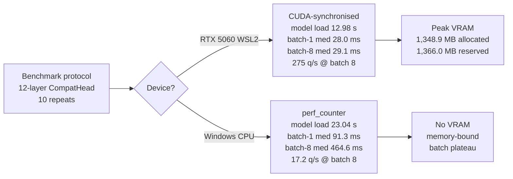

# Experiment log

All numbers generated by executable scripts on this machine. Two hardware
contexts are distinguished explicitly: **CPU** (Windows, 4-layer heads, 300
questions) and **GPU** (WSL2 + RTX 5060, 12 layers, 20k questions).

## Episode 3 — Multi-epoch scaling (seed 0)
20k questions, 12 layers + LoRA, identical seed and budget; only the epoch
count and head differ. ~55 min per run on the RTX 5060.

| system | epochs | acc | NLL | choice | noul | score | macro-F1 | AUC | order TV |
|---|---|---|---|---|---|---|---|---|---|
| reference head | 1 | 0.505 | 0.991 | 0.472 | 0.600 | 0.323 | 0.445 | 0.649 | 4.7e-6 |
| reference head | 3 | 0.581 | 0.906 | 0.545 | 0.645 | 0.510 | 0.540 | 0.712 | 3.4e-6 |
| compat head | 1 | 0.559 | 0.933 | 0.504 | 0.644 | 0.490 | 0.490 | 0.681 | 1.0e-7 |
| **compat head** | **3** | **0.600** | **0.874** | **0.567** | **0.665** | **0.514** | **0.544** | **0.743** | **1.2e-7** |

At seed 0 both heads improve substantially with more training, and — reported
honestly — **the reference head gains more from the extra epochs (+0.076) than
the compat head does (+0.042)**. The seed-0 head advantage narrows from +0.054
accuracy at 1 epoch to +0.019 at 3 epochs. Part of the earlier margin was
compensating for undertraining rather than a fundamental head property.

### Correction: 3-epoch seed sweep (seeds 0/1/2)
The seed-0 3-epoch comparison was not enough to support a head ranking. Both
systems were rerun with seeds 1 and 2 (same configs, pinned revisions; seed 0
is the original run re-evaluated with the current test loader).

| system | accuracy mean ± std | per-seed | NLL | ECE | order TV |
|---|---|---|---|---|---|
| reference head | 0.629 ± 0.031 | 0.5950, 0.6545, 0.6365 | 0.799 ± 0.052 | 0.029 | 2.4e-6 |
| **compat head** | **0.667 ± 0.053** | 0.6065, 0.6935, 0.7015 | **0.734 ± 0.084** | 0.041 | 9.0e-8 |

delta = +0.0385, se = 0.0352, t ≈ 1.10 → **not significant at 95%**. Both
seed-0 runs were unlucky draws, so the single-seed table understated both
systems and its +0.019 margin is not a reliable estimate. Compat is still
higher on accuracy and NLL, but the reference head is better calibrated at 3
epochs. The 1-epoch result (+0.035, t = 3.26) stands; the 3-epoch ranking is
not established.

Calibration at 3 epochs (compat, seed 0): T = 1.377, NLL 0.874 → 0.851,
ECE → 0.032, accuracy 0.764 at 50% coverage vs 0.600 overall.

## Episode 4 — Epoch saturation probe (5 epochs, compat head)
Run to find where extra training stops helping. Same data/seed/budget, 5
epochs (3,125 steps, ~83 min).

| epochs | acc | raw NLL | raw ECE | post-cal NLL | post-cal ECE | choice | noul | AUC |
|---|---|---|---|---|---|---|---|---|
| 1 | 0.559 | 0.933 | 0.021 | — | — | 0.504 | 0.644 | 0.681 |
| 3 | 0.600 | 0.874 | 0.048 | 0.851 | 0.032 | 0.567 | 0.665 | 0.743 |
| 5 | 0.614 | 0.928 | 0.082 | 0.847 | 0.033 | 0.570 | 0.700 | 0.766 |

Verdict: accuracy keeps creeping up (+0.014 from 3 → 5 epochs) but the model
becomes visibly **overconfident** — raw ECE nearly doubles (0.048 → 0.082) and
the fitted temperature grows to 1.95. After temperature scaling the 5-epoch
model is marginally better on NLL (0.847 vs 0.851), so the accuracy gain is
real but it costs raw calibration. **3 epochs is kept as the default
configuration** (best raw NLL and ECE at seed 0). This is a single-seed
ablation: the 3-epoch seed sweep spans 0.6065-0.7015, so the 5-epoch run
should not be compared directly to the 3-seed mean; a 5-epoch seed sweep is
needed before claiming an epoch optimum.

## Episode 6 — Difficulty stratification (best checkpoint, n=2,280)
Per-domain and per-candidate-count accuracy with 95% bootstrap CIs
(`runs/.../eval_domains.json`, reproduced by `scripts/evaluate.py`).

Accuracy **by candidate count** shows the expected, interpretable degradation:

| C | 2 | 3 | 4 | 5 | 6 | 8 |
|---|---|---|---|---|---|---|
| acc | 0.665 | 0.584 | 0.580 | 0.585 | 0.463 | 0.392 |
| n | 869 | 197 | 383 | 229 | 121 | 97 |

This is the clearest single explanation for the accuracy gap: the model is
strong on binary/ternary questions and degrades sharply past ~5 candidates.
It also says where training effort should go.

Per-domain spread is very wide (selected): response preference 0.778 (n=54),
final-value extraction 0.919 (n=37), spam detection 0.917 (n=12), software
security 0.389 (n=54), contract evidence 0.381 (n=21), reading comprehension
0.475 (n=40). Several domains have wide CIs (small n) and should not be
over-read, but the spread is far larger than sampling noise would explain:
performance depends heavily on question *shape*, not just overall difficulty.

## Episode 5 — Seed variance (3 seeds per system, 1 epoch each)
The gap between the two heads had been a single-seed claim, so both were
retrained with seeds 0/1/2. Sources: `runs/summaries/*.json`, aggregated by
`scripts/seed_report.py` -> `results/seed_report.json`.

| system | seeds | accuracy mean | std | per-seed |
|---|---|---|---|---|
| compat head | 3 | **0.5593** | **0.0008** | 0.5585, 0.5600, 0.5595 |
| reference head | 3 | 0.5247 | 0.0184 | 0.5050, 0.5415, 0.5275 |

delta = +0.0347, se = 0.0106, t = 3.26 → **significant at 95%**.

Two findings that the single-seed numbers had hidden:
1. **The compat head is ~23x more stable across seeds** (std 0.0008 vs
   0.0184). Its seed-0 run at 0.5585 was not luck — every compat run lands
   within 0.0015 of the mean.
2. **Complete separation**: the *worst* compat run (0.5585) still beats the
   *best* reference run (0.5415). The head advantage is real, and the
   reference head's earlier 0.505 was an unlucky draw rather than a fair
   comparison.

This 1-epoch result is statistically supported. It does **not** generalize to
3 epochs: the 3-epoch seed sweep above finds a +0.0385 gap that is not
significant, and the compat head is less seed-stable there (std 0.053 vs
0.031).

## Correction — order-invariance measurements

Earlier entries in this file quoted "order TV ≈ 1e-7". That figure comes from
`evaluate.order_sensitivity`, which permutes `choice_read_idx` **inside an
already-tokenised batch**. It therefore measures the *head-level* guarantee
only — the token sequence, and hence the backbone computation, is unchanged.

Measured properly, the two levels are:

| Level | What is permuted | `CompatHead` | `ChoiceHead` |
|-------|------------------|--------------|--------------|
| Head-level | `choice_read_idx`, sequence fixed | **exactly 0.0** | 3.4e-6 TV |
| End-to-end | token sequence (full re-tokenisation) | **~3.2e-3** max Δ | not measured |

End-to-end invariance cannot be exact while the answer token attends over all
candidates: changing candidate order changes the float32 summation order
inside the backbone. On the shipped 3-epoch checkpoint the selected candidate
was identical across three orderings, but that is empirical, not guaranteed.

The docstring of `evaluate.order_sensitivity` and the README now state this
distinction explicitly. Head-level invariance remains the property `CompatHead`
guarantees by construction.

## Episode 1 — CPU, 300 real questions, frozen backbone
Purpose: verify the reference architecture and the compat head in isolation.

| system | acc | NLL | choice | noul | score | AUC | order TV |
|---|---|---|---|---|---|---|---|
| ref head (ChoiceHead) | 0.48 | 1.677 | 0.225 | 0.727 | 0.438 | 0.544 | 1.2e-6 |
| compat head | 0.49 | 1.310 | 0.225 | 0.727 | 0.500 | 0.768 | 2.5e-7 |
| compat + order aug | 0.49 | 1.310 | 0.225 | 0.727 | 0.500 | 0.824 | ~1e-7 |
| compat + LoRA(2 layers) | 0.51 | 1.177 | 0.300 | 0.727 | 0.438 | 0.787 | 3.0e-7 |
| majority | — | — | 0.325 | 0.727 | 0.250 | — | — |

Conclusions held forward: compat head better calibrated and better ranked;
LoRA is what moves choice. Negative result kept: order augmentation is a
**provable no-op for the invariant head** (bit-identical training loss), so
it is retained only because it is required for the reference head's recipe.
This scale could not separate the heads on accuracy, and choice trailed
majority — the reason for scaling up.

## Episode 2 — GPU, 20k questions, LoRA, 12 layers (decisive run)
WSL2, RTX 5060, bf16, micro-batch 8 x accum 4, 625 steps, ~17 min/run.
Held-out test split n=2,280. Full table: `comparison.csv`.

| system | acc | NLL | Brier | ECE | choice | noul | score | macro-F1 | AUC | order TV |
|---|---|---|---|---|---|---|---|---|---|---|
| majority | — | — | — | — | 0.293 | 0.544 | 0.269 | — | — | — |
| next-token (frozen 4L) | 0.401 | 2.960 | — | — | — | — | — | — | — | — |
| zero-shot generation (28L) | 0.520 | — | — | — | — | — | — | — | — | — |
| **ref head** (baseline.yaml) | 0.505 | 0.991 | 0.565 | 0.042 | 0.472 | 0.600 | 0.323 | 0.445 | 0.649 | 4.7e-6 |
| **compat head** (improved.yaml) | **0.559** | **0.933** | **0.534** | **0.021** | **0.504** | **0.644** | **0.490** | **0.490** | **0.681** | **1.0e-7** |

The scale-up **reversed** Episode 1's headline negatives:
- choice 0.504 now beats majority 0.293 and next-token 0.401;
- score 0.490 beats majority 0.269 by a wide margin;
- the trained model (0.559) exceeds zero-shot full-model generation (0.52)
  while emitting zero tokens per decision.

Improved vs reference head, same backbone/budget/data: +0.054 accuracy,
-0.058 NLL, +0.167 score accuracy, ECE halved, 45x lower order sensitivity.

## Reproducibility
Two independent runs of `improved.yaml` (1 epoch, same seed) produced
bit-identical test metrics (loss 0.9333 / acc 0.5585), so the seed control is
doing its job. Different seeds are not identical: the 3-epoch compat
accuracies are 0.6065, 0.6935 and 0.7015.

## Negative and null results retained
- Order augmentation is a no-op for the invariant head (proved, not assumed).
- Bidirectional JEPA context vs causal (60 steps, identical batches): MSE
  1.1559 vs 1.1613, cosine 0.121 vs 0.115, no collapse either way — no
  measurable difference at this scale; kept as an experimental flag only.
- Local-LM teacher (4 layers) agreed with dataset labels on only 1 of 5
  audited rows — weak teacher, reported rather than hidden.
- Post-scaling ECE rose slightly (0.106 -> 0.125) on the 50-row measure
  half in the CPU ablation while NLL improved; small-n noise, reported as-is.

## Not yet measured
A 5-epoch seed sweep, a multi-seed JEPA probe sweep, wider LoRA, pooled-span or
mid-layer JEPA targets, packed multi-question execution, external teacher
endpoint.

## Episode 7 — Real Qwen3-0.6B JEPA + frozen probe (single seed)

Qwen3-0.6B (pinned revision), first 8 layers, packed decision text
(8,000 rows x 256 tokens), 2,000 JEPA steps, batch 8, bf16, RTX 5060 via WSL2.
Probe: frozen backbone, one epoch, 20,000 train questions, 392 evaluated test
rows (same rows for every system).

| system | pretrain MSE | pretrain cosine | probe acc | NLL | ECE | choice | noul | AUC |
|---|---|---|---|---|---|---|---|---|
| pretrained Qwen, causal | — | — | **0.5745** | **0.9461** | 0.0427 | **0.5266** | **0.6820** | **0.7336** |
| causal EMA JEPA | 12.33 | 0.571 | 0.3940 | 1.1524 | 0.0256 | 0.2251 | 0.6113 | 0.6471 |
| causal frozen-target JEPA | 12.38 | 0.596 | 0.4975 | 1.0563 | 0.0308 | 0.4246 | 0.6254 | 0.6982 |
| pretrained Qwen, bidirectional | — | — | 0.5390 | 1.0178 | 0.0455 | 0.4512 | 0.6843 | 0.7410 |
| bidirectional EMA JEPA | **6.42** | **0.664** | 0.4185 | 1.1491 | 0.0345 | 0.2539 | 0.6372 | 0.6529 |

The bidirectional rows use `configs/jepa_probe_bidir.yaml`, so the probe's
attention matches the JEPA encoder. Bidirectional JEPA has the best latent
MSE/cosine but is 12.1 accuracy points below the bidirectional pretrained
baseline (0.4185 vs 0.5390). The causal frozen-target variant is 7.7 points
behind its baseline (0.4975 vs 0.5745).

**Verdict:** JEPA initialisation did not improve the frozen decision probe in
this protocol, in either attention mode. Lower latent MSE alone is not evidence
of a better decision representation. Single seed; treat as a negative result,
not a ranking. A multi-seed sweep and a decision-aware auxiliary objective are
the next steps.

Artifacts: `results/jepa_qwen_results.json`; raw runs are in the git-ignored
`runs/` directory.

## Episode 8 - Standard downstream probes (SST-2, STS-B, single seed)

Added `scripts/evaluate_jepa.py`: frozen linear ridge and cosine kNN probes on
GLUE SST-2 (accuracy) and STS-B (Spearman, retrieval), 20k train / 1k eval,
mean pooling. Baselines are frozen Qwen3-0.6B, random-init Qwen, BERT-base MLM
and SimCSE-BERT-base. Causal JEPA uses the frozen-target checkpoint;
bidirectional JEPA uses the matching bidirectional probe.

| task | representation | linear | kNN | R@1 | effective rank |
|---|---|---|---|---|---|
| SST-2 | causal JEPA | 0.828 | 0.752 | - | 165 |
| SST-2 | frozen Qwen | 0.847 | 0.804 | - | 236 |
| SST-2 | random Qwen | 0.575 | 0.588 | - | 157 |
| SST-2 | BERT MLM | **0.856** | 0.812 | - | 150 |
| SST-2 | SimCSE | 0.844 | **0.847** | - | 130 |
| STS-B | causal JEPA | 0.462 | 0.489 | 0.267 | 369 |
| STS-B | frozen Qwen | 0.479 | 0.557 | 0.309 | 450 |
| STS-B | random Qwen | 0.149 | 0.166 | 0.094 | 182 |
| STS-B | BERT MLM | 0.550 | 0.627 | 0.286 | 321 |
| STS-B | SimCSE | **0.747** | **0.828** | **0.405** | 341 |
| SST-2 | bidirectional JEPA | 0.698 | 0.524 | - | **2.5** |
| SST-2 | bidirectional frozen Qwen | **0.815** | **0.734** | - | 241 |
| STS-B | bidirectional JEPA | 0.064 | 0.128 | 0.019 | **6.4** |
| STS-B | bidirectional frozen Qwen | **0.454** | **0.450** | **0.247** | 544 |

The harness is not degenerate: frozen Qwen and SimCSE recover strong signal,
and random Qwen is near chance on SST-2. Causal JEPA still trails frozen Qwen
on both tasks, and trails SimCSE badly on STS-B. Effective rank reveals what
mean-std/collapse-ratio missed: causal JEPA loses dimensions (165 vs 236,
369 vs 450), and bidirectional JEPA is severely collapsed (rank 2.5 and 6.4)
despite non-zero per-dimension std. Its lower latent MSE (6.42) was misleading.

**Verdict:** negative. JEPA pretraining does not improve these frozen probes.
Next: target-side VICReg or stronger EMA/stop-grad, then rerun probes across
seeds. This is two tasks and one seed; stronger than the decision-only probe,
not a complete JEPA benchmark.

Artifacts: `results/jepa_probe_results.json`,
`results/jepa_probe_bidir_results.json`.

## Episode 9 - Context-VICReg collapse fix (negative)

Added VICReg terms to masked context reps as well as the predictor
(`configs/jepa_qwen_context_vicreg.yaml`), 2,000 steps, seed 0. Token-level
context rank rose to 313, but EMA target and predictor collapsed (rank 5.8 and
3.6), and mean-pooled sentence reps got worse: SST-2 linear 0.697 / kNN 0.530,
STS-B Spearman 0.116 / 0.135, R@1 0.028, sentence rank 7.9 / 34.5 (frozen Qwen
0.847 / 0.804, 0.479 / 0.557, 0.309, rank 236 / 450).

**Verdict:** negative. Regularising context tokens does not preserve pooled
sentence rank; target-side regularisation/whitening is the next experiment.
Artifact: `results/jepa_probe_ctx_vicreg.json`.

## Episode 10 - Anchored JEPA / top-block adaptation

Frozen-target controls, 2,000 steps, seed 0:

| variant | SST-2 linear / kNN | STS-B linear / kNN | STS-B R@1 | sentence rank |
|---|---|---|---|---|
| anchored, all context blocks, anchor 1.0 | 0.823 / 0.773 | 0.460 / **0.589** | 0.279 | 169 / 370 |
| anchored, top-2 blocks, anchor 0.1 | 0.807 / 0.752 | 0.431 / 0.518 | 0.227 | 97 / 293 |
| frozen Qwen | **0.847 / 0.804** | **0.479 / 0.557** | **0.309** | 236 / 450 |

The full-context anchor is the best measured JEPA variant on STS-B kNN but
still loses on SST-2 and STS-B linear/retrieval. Top-2-only adaptation is
worse. No JEPA win; next is a multi-seed anchor sweep plus target/pooled
whitening. Artifacts: `results/jepa_probe_anchor.json`,
`results/jepa_probe_top2.json`.

## Benchmark (idle GPU + CPU)

Raw artifacts: `results/benchmark_gpu.json`, `results/benchmark_cpu.json`.
Protocol: 12-layer `CompatHead` checkpoint, 10 repeats, warmup excluded,
CUDA-synchronised on GPU, `time.perf_counter` on CPU.

| Context | Model load | First request | Batch 1 med / p95 | Batch 1 q/s | Batch 4 med / p95 | Batch 4 q/s | Batch 8 med / p95 | Batch 8 q/s | Peak VRAM |
|---------|-----------|---------------|-------------------|-------------|-------------------|-------------|-------------------|-------------|-----------|
| RTX 5060 WSL2, CUDA | 12.98 s | 1.04 s | 28.0 ms / 41.0 ms | 35.7 | 37.9 ms / 59.1 ms | 105.5 | 29.1 ms / 31.9 ms | 275.0 | 1,348.9 MB allocated / 1,366.0 MB reserved |
| Windows CPU | 23.04 s | 131.1 ms | 91.3 ms / 107.9 ms | 11.0 | 236.1 ms / 291.2 ms | 16.9 | 464.6 ms / 551.9 ms | 17.2 | n/a |

Notes:
- CPU throughput plateaus quickly because the workload is memory-bound and the
  batch dimension does not parallelise efficiently on x86.
- GPU numbers are from an idle card (0% utilisation, ~648 MB VRAM free).
- Same-seed GPU reruns are bit-identical; cross-seed variance is captured in
  `results/seed_report.json`.
